# Teaching agent state machine

High-level view of how a session's teaching agent is constructed per turn, and the phases it moves through. The agent is **stateless per turn**: it is rebuilt from the persisted record every POST and discarded at turn end; the record (transcript) is the source of truth. Which agent is built is a construction branch, not a handoff.

## Diagram

```mermaid
stateDiagram-v2
    [*] --> Prober: new teaching session

    state "PROBER (probe phase) - Tools: quiz (no nodeId), ask_user_question, probe_done, read/pdf/research, list_sessions/list_propositions (gated) - Prompt: shared base + prober doctrine + shared" as Prober
    state "TEACHER PLANNING (planning phase) - Tools: plan_init, quiz (nodeId+type), ask_user_question, research, demo, visual, pdf/read/find/ls/grep, graph readers - Prompt: shared base + teacher fragments + shared" as Planning
    state "TEACHER TEACH (teach phase) - Same toolset and prompt as planning; first nodeId-tagged quiz flips the phase" as Teach
    state "PRACTICE AGENT (practice sessions only) - Tools: problem, conclude (+ file/map readers) - Prompt: practice base + practice doctrine only" as Practice
    state "ASK AGENT (ask threads only) - No tools, one fast model call - Prompt: ask instructions + retrieved context" as Ask

    Prober --> Planning: probe_done in transcript (queues handoff steer; assessment to plan flow)
    Planning --> Teach: first quiz call tagged with a nodeId (phase inferred, not gated)
    Teach --> Teach: mid-lesson plan_init rewrites (no re-present needed)
    Teach --> Planning: never - phase only advances

    [*] --> Practice: session kind = "practice" (no prober to teacher split)
    [*] --> Ask: ask thread (no tools, own prompt)

    note right of Prober
        PROBER - system prompt summary
        Shared base: agent identity ("install understanding"), philosophy (measure, then plan, then teach at the edge; logistics absorbed), accuracy rule.
        Prober doctrine: two measurements only - goal (ask_user_question) and what he already knows (quiz/explain, no nodeId). Read persistent map (list_sessions/list_propositions). Reason strands. Binary-search each strand (floor/ceiling), one question at a time, from high to low. Conclude with probe_done: one entry per strand (name, floor, ceiling, misconceptions, build-from). Grounding: read his files/PDFs directly.
        Shared (trailing): voice, accuracy, mental model (thinking fields), question tools craft, confidence reading, learner files, formatting.
    end note

    note right of Planning
        TEACHER (planning) - system prompt summary
        Shared base + teacher fragments: method (Principle i unconditional truths first; Principle ii "how could I have discovered this?"), planning doctrine, teaching one-step, predictions (predict/check), question principles, jobs (research/pdf), demos/visuals, plus shared.
        Planning focus: highest-leverage step; scope field; unconditional truths; minimal tree (nothing held re-taught, nothing off-path); motivated discovery path. Write the map with plan_init (mermaid graph TD, slug nodes, --> requires edges). Present plan in prose + map; stress-test roots; presenting ends the turn; learner confirms or requests changes; no teaching in the presenting turn.
    end note

    note right of Teach
        TEACHER (teach) - system prompt summary
        Same composition as planning. Teaching focus: one reasoning step at a time; predict (open, before step) then teach then check (collapsed, after). Every step verified with quiz carrying nodeId + type (predict/check); nodeId is position, never completion. Socratic vs expository per step. Teach first, check second; finish thought before firing. Async research/demo/visual with announce-and-continue discipline. Formatting: markdown/LaTeX, diagrams paired with prose, callouts, pins. Map moves with learner; mid-lesson plan_init rewrites are normal.
    end note

    note right of Practice
        PRACTICE - system prompt summary
        Own base + doctrine only (no shared fragments). Base: practice identity (strengthening, not assessment/exam), opening straight to problems, tool mechanics (problem/conclude, one active problem, pause law, hints ladder, fact checks, side tools). Doctrine: inactivity constraint, modes (recall/discrimination/composition), stream selection rules, hint ladder R0-R5, claimed-answer handling, progression, arc (open warm then interleaved body then retest misses), standing prohibitions.
    end note
```

## Phase fold (event-driven)

- **probe** (prober) — `probe_done` → **planning** (teacher) — first `nodeId`-tagged quiz call → **teach** (teacher).
- The verdict gate is dead: presenting the plan ends the teacher's turn; the learner's next message is a natural reply (revise or go-ahead). The plan→teach seam is inferred from the first tagged quiz.
- `nodeId` is a position signal, never completion. Current node = most recent tagged quiz call; visited = all earlier tagged nodes. No done ledger.
- Mid-lesson `plan_init` rewrites need no gate.

## Construction rule

- `probe_done` part in transcript ⇒ build teacher agent; otherwise build prober.
- Practice sessions (kind `"practice"`) build the practice agent from turn 1.
- Ask threads build the ask agent with an injected prompt and no tools.
- Engines/prompts are per-request; the agent is discarded at turn end.
